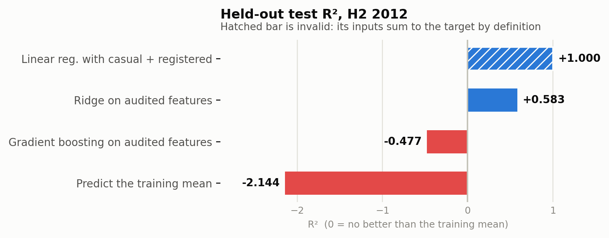

Agents can do a lot of the routine work in a capstone project. They read your code, write new code, run it, and fix errors. Tasks that took a week can take an afternoon.

What an agent does not know is what your result is supposed to mean. It stops when the code runs and the output looks reasonable. A pipeline can run without errors, report a high score, and still be answering the wrong question.

This tutorial does two things. First it shows how to build an agent: giving it standing instructions, choosing which tools it can use, packaging a workflow it can repeat, adding a second agent to review its work, and writing your own agent in Python with the Agent SDK. Then it shows how to build checks into that agent, so it has to pass them before the work counts as done.

You will do this on one example: forecasting daily bikeshare demand, from a dataset with a leakage trap in it. The checks are a test that fails if a leaked column reaches the model, a split that respects time order, and a baseline reported with every score. These are what let you defend the result in your report.

| **Audience** | DSC 180A capstone students. Comfortable with Python, pandas, and scikit-learn. No prior agent experience assumed. |
|---|---|
| **Running example** | Forecasting daily bikeshare demand — a small, time-series problem with a leakage trap built into the data. |
| **You will need** | Claude Code installed, Python 3.11+, and about 400 MB of disk. Setup commands are in Appendix A. |
| **What you will build** | A working agentic repo with a verification loop, a hook, a subagent, a skill, and a batch auditor. |

## Lesson outline

#### A. The agentic loop and its failure mode

- What an agent actually does: read, act, observe, repeat — and why the loop stops when the work merely looks done.
- Context as the binding constraint. Why performance degrades as context fills, and why /clear between unrelated tasks outperforms one long heroic session.
- The trust-then-verify gap: plausible code that fails on cases nobody enumerated.

#### B. Specification before generation

- Plan mode as the separation of research from execution.
- Letting the agent interview you, then writing SPEC.md, then starting a fresh session to execute it.
- CLAUDE.md as the project's standing constraints — and the failure mode of writing too much in it.

#### C. Verification as the unit of methodology

- The central move: **every claim becomes a check.** "We avoided leakage" becomes a test that fails if a forbidden column enters the feature set.
- Tests, baselines, and assertions as the agent's stopping condition rather than your attention.
- Adversarial review in a fresh context: why the model that wrote the code should not be the one grading it.

#### D. Structural guarantees

- Hooks: deterministic, non-negotiable, run every time. Where they beat instructions.
- Permissions and sandboxing: allowlists, denylists, and protecting raw data from modification.
- Subagents: isolated context for research and for review.
- Skills: packaging a workflow so the twelfth feature is added the same way as the first.

#### E. Building your own agents

- Claude Code versus the Agent SDK: the same engine, a different harness.
- Custom tools — giving deterministic work to code and judgement to the model.
- Structured output, concurrency, and failure handling in a batch run.

#### F. Research integrity

- Attribution: what the agent did, what you decided, and how the report should say so.
- Reproducibility: seeds, pinned versions, and a pipeline that runs from one command.
- Whether the question is worth asking, and whether the answer is believable.

## Part 1 · Why methodology changes

For most of your degree, writing the code was the slow step. You thought carefully before you typed because typing was expensive. That constraint quietly enforced a lot of methodology: you did not try forty feature sets because forty feature sets was a week of work.

That constraint is gone. An agent will try forty feature sets in an afternoon. What it will not do is notice that thirty-nine of them were invalid for a reason nobody wrote down.

The bottleneck has moved from *producing* analysis to *trusting* it. Everything in this tutorial follows from this.

**The running example**

We forecast daily bikeshare ridership in Washington, DC for 2011–2012 (Fanaee-T and Gama; the canonical copy lives at UCI). Each row is one day: weather, calendar context, and three count columns — casual riders, registered riders, and cnt, the total.

**The trap:** `casual + registered == cnt` exactly, on every row. A model handed those two columns achieves a perfect score by learning addition. It forecasts nothing, because at prediction time you would not know either input: they are components of the very quantity you are trying to predict.

A second, subtler problem sits underneath: ridership grew about 65% from 2011 to 2012. Any honest evaluation must therefore predict a future that does not look like the past — which turns out to matter more for model choice than anything about hyperparameters.

### Where we end up

This is the result the tutorial produces. Read it before you start, so you know what you are working toward.



Test-set R² for four models in the second half of 2012, after training in 2011. Source: reports/metrics.json, produced by make all.

Three things in that chart are worth more than a lecture:

1. **The perfect score is the invalid one.** R² = 1.000 is not an achievement; it is the signature of leakage.
1. **The mean baseline scores −2.1.** Predicting the 2011 average for every day in late 2012 is much worse than useless, because the distribution moved. Without that number on the page, +0.58 is uninterpretable.
1. Gradient boosting loses to ridge regression though it still beats the mean baseline, so the two red bars are negative for different reasons. A tree cannot predict a value outside the range it saw in training, and 2012 is mostly outside that range.

> **This is the shape of a good data science pipeline project finding.** Not "our model achieved R² = 0.58" but "the naive evaluation gives 1.000 and is invalid; under a temporal split the mean baseline is strongly negative, a linear model reaches 0.58, and gradient boosting fails because it cannot extrapolate a growing trend." The second version is a result. The first is a number.

## Part 2 · The five primitives

Claude Code gives you five places to put knowledge. Choosing correctly among them is most of the skill. The distinction that matters most is the third column: instructions can be ignored; hooks cannot.

| **Primitive** | **Lives in** | **Enforcement** | **Use it for** |
|---|---|---|---|
| **`CLAUDE.md`** | Project root | Advisory | Standing constraints that apply to every session: commands, forbidden columns, the split rule. Loaded every time, so keep it short. |
| **Plan mode** | Shift+Tab | Session-scoped | Separating exploration from execution. The agent reads and reasons but cannot edit. |
| **Skills** | .claude/skills/<name>/SKILL.md | Advisory, on demand | Workflows you repeat: adding a feature, running an ablation, writing a weekly update. Loaded only when relevant, so they can be long. |
| **Subagents** | .claude/agents/<name>.md | Isolated context | Research that would flood your context, and review that must not be done by the author. |
| **Hooks** | .claude/settings.json | Deterministic | Guarantees. A hook runs every time, whatever the agent intends. This is where methodology stops being a request. |

### The rule of thumb

If forgetting it would invalidate a result, it is a hook or a test. If forgetting it would waste an hour, it is CLAUDE.md or a skill. **Do not put load-bearing methodology in prose.**

### Prompting, briefly

Prompting matters less than people think and less than the repository you prompt inside. But three habits pay for themselves immediately.

| **Habit** | **Weak** | **Strong** |
|---|---|---|
| State the check | "Build a demand model." | "Build a demand model. Report validation R² against a mean baseline and run make test before you tell me it works." |
| Name the source | "Why is the data weird?" | "Read src/ingest.py and data/raw/bike\_daily.csv, then tell me which columns have unexpected label values." |
| Say what is out of scope | "Improve the model." | "Improve validation R² by changing features only. Do not touch the split, the baseline, or reports/." |

> **Have the agent interview you.** For anything larger than a single change, start with: "I want to build X. Interview me in detail using the AskUserQuestion tool. Ask about edge cases and tradeoffs I might not have considered. Then write a complete spec to SPEC.md." Then open a fresh session to execute the spec. The interview surfaces decisions you were about to make by accident.

## Part 3 · The tutorial

Eight steps. Each one gives you the prompt to type, what should happen, and why it is the methodological point rather than a keystroke. Run them in order; the bugs in Step 5 only appear because of the choices in Step 4.

Appendix A has the setup.

### Step 1 · Give the project standing constraints

Create the project directory, initialise git, and start Claude Code in it. Then:

```text
/init
```

This generates a starter CLAUDE.md. It will be generic, because the project is empty. Replace it with constraints the agent could not infer — which, at this stage, means the constraints you already know from the data dictionary.

```
# Bikeshare demand capstone

Daily Capital Bikeshare counts, 2011-2012. We forecast `cnt` (total daily
rides) from calendar, weather, and lagged-demand features.

## Non-negotiable rules
- **Never** put `casual`, `registered`, `instant`, or `cnt_2d_bfr` in a
  feature set. `casual + registered == cnt` exactly. See `src/config.py`.
- **Never** split this data randomly. Use `src.train.temporal_split`.
  Train = 2011, valid = H1 2012, test = H2 2012.
- Report the mean baseline alongside every model score.
```

**Why is this the first step?** You are writing down what you know before the agent has a chance to guess. Everything in that file is a decision you made as the researcher; none of it is derivable from the code, because there is no code yet. Run `/context` to confirm it is loaded.

> **Keep it short.** A bloated CLAUDE.md is worse than a short one — important rules get lost in noise and the agent starts ignoring the file wholesale. For each line, ask: would removing this cause a mistake? If not, cut it. Domain knowledge that is only sometimes relevant belongs in a skill, which loads on demand.

### Step 2 · Explore and plan, without writing code

Enter plan mode (`Shift+Tab` until the status bar reads `plan mode on`, or start with `claude --permission-mode plan`). The agent can read and run read-only commands, but cannot edit.

```text
Download the daily bikeshare CSV from the URL in README.md into
data/raw/. Then characterise it for me: row count, date range, every
column with its dtype and distinct values if categorical, and any
missing dates in the calendar. Do not build features or models yet.

Then tell me specifically: which columns could leak the target, and
what would go wrong if I split this data randomly?
```

Read the answer carefully — this is the one moment in the session where the agent is doing research rather than production, and its output is an input to your judgement rather than a deliverable.

Expect it to find: 728 rows spanning 2011-01-03 to 2012-12-31; a weather column with the labels GOOD, MISTY and BAD; and one absent calendar day. It should identify casual and registered as leakage. It may or may not spot the missing day, which is exactly why you asked.

**Why this is separate from Step 3.** Letting an agent jump to code produces code that solves the wrong problem, confidently. Plan mode is cheap insurance. Press `Ctrl+G` to open the plan in your editor and change it before approving — the plan is yours, not the agent's.

> **Planning has a cost.** Do not use plan mode for a typo or a log line. It earns its keep when the approach is uncertain, the change spans several files, or you do not yet know the data. If you could describe the diff in one sentence, skip it.

### Step 3 · Ask naively, and get the answer you deserve

Leave plan mode. Now ask the way a hurried student would ask — this is a deliberate demonstration, so type it exactly:

```text
Build a model to predict cnt from the other columns. Report R-squared.
```

The agent will drop the target, use everything else, split the data, fit a model, and report something close to a perfect score. Ours reports:

```
Features: ['casual', 'registered', 'temp', 'hum']
Test R^2 = 1.000000
```

**Stop here and sit with it.** Nothing went wrong mechanically. The agent did exactly what you asked, the code has no bugs, the score is real, and the result is worthless. There is no prompt phrasing that reliably prevents this, because the problem is not in the prompt — it is that the correctness criterion existed only in your head.

> **The reflex to build.** A result substantially better than you expected is a bug report until proven otherwise. In a capstone, the moment you see a number you would be thrilled to put in the report is the moment to go looking for the reason it is wrong. Train this reflex now; it is the most transferable thing in this lesson.

Ask the agent to explain its own result:

```text
Check whether any subset of the features you used is an exact linear
combination of cnt. Show me the residual, not your reasoning.
```

It will find that casual + registered reproduces cnt to within floating-point error. Good — now make that finding permanent.

### Step 4 · Turn the finding into a test

This is the pivot of the whole lesson. A lesson the agent learned in conversation is gone when you clear the context. A lesson written as a test runs forever.

```text
Write tests/test_leakage.py. It must fail if any forbidden column
reaches the feature set. Include a test that documents WHY: assert that
casual + registered == cnt on every row.

Also add src/config.py with a LEAKAGE_COLS set as the single source of
truth, and have the feature builder derive its column list by excluding
that set so the builder and the tests read the same definition.

Run the tests and show me the output. Do not build the model yet.
```

The design instruction in the middle is the important one. One named constant feeds both the feature builder and the tests, so the two cannot drift apart. Be clear about what it does not buy you: a denylist admits a new column silently, because nobody thought to forbid it, while an allowlist drops one silently instead. Pick the failure you would rather have, and write it down. You are specifying a mechanism, not just an outcome.

```
# src/config.py
LEAKAGE_COLS = {"casual", "registered", "cnt", "instant", "cnt_2d_bfr"}

# Not leakage, but unusable: a raw time index lets a tree split on
# "after date X" and then predict a flat constant for every future date.
TIME_INDEX_COLS = {"yr", "days_since_2011"}
# tests/test_leakage.py
def test_leakage_identity_holds(feats):
    """Documents *why* casual and registered are forbidden."""
    assert (feats.casual + feats.registered == feats[TARGET]).all()

def test_no_forbidden_features(feats):
    cols = set(feature_columns(feats))
    assert not (cols & FORBIDDEN), f"forbidden columns: {cols & FORBIDDEN}"
```

Why the identity test earns its place. It documents the reason, so a teammate in week eight who wonders why two perfectly good columns are banned gets an answer. Be precise about what its neighbour does, though: `test_no_forbidden_features` asserts a property `feature_columns` already guaranteed by construction, so it will never catch a new leaky column in the data. What it catches is someone editing `feature_columns` which is exactly the failure the hook in Step 7 demonstrates.

### Step 5 · Rebuild features under the contract

Now let the agent build the modelling table, with the tests in place as its stopping condition.

```text
Write src/features.py. Calendar features, a cyclical month encoding,
an ordinal weather severity, and lagged demand: cnt_lag_1, cnt_lag_7,
and a 7-day rolling mean.

Constraints: every aggregation shifts before it aggregates, so no
feature contains information from its own day. Run make test after
each change and show me the failures before you fix them.
```

**The last sentence matters.** "Show me the failures before you fix them" turns a silent self-correction loop into a visible one. You want to see what broke, because two of the breaks are real findings about the data.

#### Bug 1 — the calendar has a hole

The lag test compares cnt\_lag\_1 on date d against cnt on d−1 in calendar terms, and it fails. The dataset is missing 2012-10-29 — Hurricane Sandy. pandas .shift(1) moves by rows, not by days, so across that gap it silently becomes a two-day lag, and every lag feature after it is quietly wrong.

```
def reindex_to_calendar(df: pd.DataFrame) -> pd.DataFrame:
    """Insert a row for every missing calendar day.

    Without this, shift(1) becomes a two-day lag across the gap and
    nothing in the data announces it.
    """
    full = pd.date_range(df.dteday.min(), df.dteday.max(), freq="D")
    return df.set_index("dteday").reindex(full).rename_axis("dteday").reset_index()
```

#### Bug 2 — a silent .map() eats 21 rows

The weather encoder was written against the UCI documentation, which describes four numeric codes. This mirror uses the labels GOOD, MISTY and BAD. Every BAD day maps to NaN and is then deleted by a downstream dropna, no error, no warning, twenty-one of the most interesting days in the dataset simply gone.

```
def encode_weather(series: pd.Series) -> pd.Series:
    """Ordinal-encode weather, failing loudly on unseen labels."""
    unknown = set(series.dropna().unique()) - set(WEATHER_ORDER)
    if unknown:
        raise ValueError(f"unmapped weather labels: {sorted(unknown)}")
    return series.map(WEATHER_ORDER).astype(float)
```

Then add the test that would have caught it without you looking:

```
def test_only_expected_rows_are_dropped(feats):
    """Rows may only vanish for the 7-day lag warm-up or a genuinely
    absent observation -- never because an encoder produced a silent NaN."""
    allowed_loss = 7 + 8 * missing_days
    lost = len(raw) - len(feats)
    assert lost <= allowed_loss, f"lost {lost}; expected at most {allowed_loss}"
```

> **Neither bug is about agents.** You could have written both by hand. The point is that at agent speed you would have shipped both, because the pipeline runs green and the numbers look plausible. The tests are what make the speed safe.

### Step 6 · Split by time, and report the baseline

```text
Write src/train.py: split by date (train 2011, valid H1 2012, test
H2 2012), fit a mean baseline, a standardised ridge, and a gradient
booster, and write reports/metrics.json.

Report valid and test R-squared and MAE for all three. Do not tune
anything against the test set.
```

```
{
  "ridge":         {"valid": {"r2": 0.6475}, "test": {"r2":  0.5833}},
  "hgb":           {"valid": {"r2": 0.2368}, "test": {"r2": -0.4766}},
  "baseline_mean": {"valid": {"r2": -0.9318}, "test": {"r2": -2.1441}}
}
```

Now ask the question the numbers demand:

```text
Gradient boosting beats the mean baseline on both splits, but falls from 0.24 on validation to −0.48 on test, while ridge holds at 0.65 and 0.58. Explain the mechanism, and show me the evidence — compare the range of cnt in train against test.Explain the mechanism, and show me the evidence — compare the
range of cnt in train against test.
```

The answer is that a tree predicts by averaging training targets in a leaf, so it cannot produce a value above the maximum it has seen. Ridership grew 65%, so most of late 2012 is above that ceiling. Ridge extrapolates through its lag coefficients and survives.

**This is your headline result**, and you only have it because the baseline and the temporal split were in place before the modelling started. Reversed — model first, evaluate later — this looks like a tuning problem and you spend a week on hyperparameters.

### Step 7 · Make the guarantee structural

Tests only help if they run. A hook runs them whether or not anyone remembers.

```text
Write a PostToolUse hook that re-runs tests/test_leakage.py whenever
a file under src/ is edited, and exits 2 with the failure output on
stderr if they fail.

Read the hook input from stdin as JSON -- CLAUDE_FILE_PATHS is not a
real environment variable. Then test the hook three ways: a src edit
with tests passing, a non-src edit, and a src edit with the guard
deliberately broken.
```

```
{
  "hooks": {
    "PostToolUse": [{
      "matcher": "Edit|Write",
      "hooks": [{
        "type": "command",
        "command": "${CLAUDE_PROJECT_DIR}/.claude/hooks/check_leakage.sh",
        "timeout": 60,
        "statusMessage": "Re-running leakage tests..."
      }]
    }]
  },
  "permissions": {
    "allow": ["Bash(make:*)", "Bash(python -m pytest:*)"],
    "deny": ["Write(./data/raw/**)", "Edit(./data/raw/**)", "Bash(rm -rf:*)"]
  }
}
```

Exit code 2 is the whole mechanism: stderr goes back to the agent as a system message, so it sees the failure and fixes it without you noticing anything happened. The `deny` rules encode a rule you should adopt for every project: raw data is immutable. Anything that needs changing gets changed downstream, in code, where it is reviewable.

#### An adversarial reviewer

The model that wrote the code is a poor judge of it. A subagent runs in its own context, sees the diff and the criteria but not the reasoning that produced them, and evaluates on its own terms.

```
---
name: leakage-auditor
description: Audits a diff for target leakage, temporal-split violations,
  and unreported baselines. Use before committing to src/.
tools: Read, Grep, Glob, Bash
model: opus
---
You are a methodology reviewer for a time-series forecasting repo. You
did not write this code and you have no stake in it being correct.
[... five explicit checks ...]
Verify each claim by reading the code or running it. Do not accept a
docstring as evidence that behaviour is correct.
Report only findings that change a number or invalidate a conclusion.
```

> **Tell the reviewer what not to report.** A reviewer asked to find gaps will find some, whether or not they exist, because that is the job it was given. Without "report only findings that change a number," you get style opinions and defensive abstractions. Over-engineering is the failure mode of unconstrained review.

### Step 8 · Package the workflow as a skill

You will add features for the next eight weeks. The twelfth should be added exactly like the first, including the parts that are tedious.

```
---
name: new-feature
description: Add a feature column with its leakage test. Use whenever
  someone asks to add, engineer, or try a new predictor.
allowed-tools: Read, Edit, Bash(python -m pytest*), Bash(make*)
---
# Current feature set
!`python -c "...print the live feature list..."`

# Adding a feature: $ARGUMENTS
1. State the availability argument in one sentence. At prediction time
   for date d, is every input known? If not, say so and stop.
2. Write the failing test FIRST in tests/test_leakage.py. Confirm it
   fails for the right reason.
3. Implement it after reindex_to_calendar. Shift before you roll.
4. Verify: make features && make test && make train. Report the
   before/after VALIDATION R2. Never report test numbers while iterating.
5. Record the decision in docs/DECISIONS.md.

If validation R2 improves by less than 0.01, say so plainly and
recommend dropping the feature.
```

**Two details worth stealing.** The `!`command`` syntax runs a shell command and injects its output before the agent reads the skill, so step 1 starts from the live feature list rather than a remembered one. And the last paragraph gives the agent permission to report a negative result — without it, an agent asked to add a feature will add a feature.

Invoke it with /new-feature humidity interaction, or just describe what you want and let it trigger on its own.

## Part 4 · Graduating to the Agent SDK

Everything so far happened inside Claude Code, with you watching. The Agent SDK is the same engine with a different harness: you write the loop, in Python, and the agent becomes a component of a program rather than a conversation.

### When to switch

| **Stay in Claude Code when…** | **Reach for the SDK when…** |
|---|---|
| You are the one reading the output. | A program is reading the output, and it needs a schema. |
| The task happens once, or a few times. | The task happens forty times, or nightly. |
| You want to redirect mid-task. | Nobody is there to redirect anything. |
| The tools you need already exist. | You need a deterministic tool the model should not attempt by reasoning. |

Our case is the third and fourth rows at once. The leakage-auditor subagent is exactly the right reviewer; we simply need to run it across every repo in the class and get back a row per repo.

### Custom tools: give the deterministic part to code

Deciding whether three float columns sum to a fourth is not a judgement call — it is least squares, and `numpy` is perfect at it while a language model is unreliable. Define it as a tool and let the model decide when to call it.

```
from claude_agent_sdk import tool, create_sdk_mcp_server

@tool("check_identity",
      "Test whether any subset of candidate columns is an exact linear "
      "restatement of the target. Returns the offending subsets.",
      {"csv_path": str, "target": str, "candidates": list})
async def check_identity(args):
    df = pd.read_csv(args["csv_path"])
    target = df[args["target"]].to_numpy(dtype=float)
    cols = [c for c in args["candidates"] if c in df.columns]

    hits = []
    for r in (1, 2, 3):
        for subset in combinations(cols, r):
            X = df[list(subset)].to_numpy(dtype=float)
            coef, *_ = np.linalg.lstsq(X, target, rcond=None)
            resid = float(np.abs(X @ coef - target).max())
            if resid < 1e-6:
                hits.append({"columns": list(subset), "max_residual": resid})

    verdict = "LEAKAGE" if hits else "clean"
    return {"content": [{"type": "text",
            "text": json.dumps({"verdict": verdict, "identities": hits})}]}

auditor_tools = create_sdk_mcp_server(
    name="audit", version="1.0.0", tools=[check_identity])
```

Run against our own data, it returns exactly what it should:

```
{"verdict": "LEAKAGE",
 "identities": [{"columns": ["casual", "registered"],
                 "max_residual": 1.8e-12}, ...]}
```

### The loop

```
async def audit_repo(repo: Path) -> dict:
    options = ClaudeAgentOptions(
        system_prompt=SYSTEM,          # the four checks, plus the output schema
        cwd=str(repo),
        mcp_servers={"audit": auditor_tools},
        allowed_tools=["Read", "Grep", "Glob", "Bash",
                       "mcp__audit__check_identity"],
        permission_mode="acceptEdits", # read-heavy; it writes nothing
        max_turns=40,
        model="claude-sonnet-4-6",
    )
    text = ""
    async for message in query(prompt=f"Audit the repo at {repo}.",
                               options=options):
        if isinstance(message, AssistantMessage):
            for block in message.content:
                if isinstance(block, TextBlock):
                    text += block.text
    try:
        return json.loads(text.strip())
    except json.JSONDecodeError:
        # Never let one malformed reply kill a 40-repo run.
        return {"repo": repo.name, "error": "unparseable", "raw": text[:500]}
```

Then bound the concurrency and write one JSON object per line, so the output is a dataframe:

```
sem = asyncio.Semaphore(4)

async def bounded(repo):
    async with sem:
        return await audit_repo(repo)

results = await asyncio.gather(*(bounded(r) for r in ns.repos))
with ns.out.open("w") as fh:
    for row in results:
        fh.write(json.dumps(row) + "\n")
```

### Three things that separate a working batch agent from a demo

1. **Constrain the output, then parse defensively.** Ask for a JSON object and nothing else — and still wrap json.loads in a try. One unparseable reply must not lose the other thirty-nine results.
1. **Scope the tools.** allowed\_tools is a security boundary, not a hint. An auditor needs to read and run; it never needs to write.
1. **Bound the concurrency.** A semaphore around gather keeps you inside rate limits and makes the run reproducible enough to debug.

> **The honest limitation.** A batch auditor is a screening instrument, not a verdict. It reliably surfaces exact identities, random splits, and missing baselines. It will not tell you whether the research question was worth asking. Use it to decide where to spend your attention, never to replace it.

## Part 5 · What this means for your capstone

### Deliverables and grading

Seven deliverables, graded out of 100. Each carries its own check, and most of those
checks are things we run rather than things we read — which is the point of the lesson
they come from. Build the repository so a wrong answer cannot pass quietly, and the
rubric mostly takes care of itself.

| # | Deliverable | Weight |
|---|---|---|
| 1 | Reproducible repository | 15 |
| 2 | `CLAUDE.md` | 10 |
| 3 | Verification suite | 25 |
| 4 | Results with baselines | 20 |
| 5 | Structural enforcement | 10 |
| 6 | Agent configuration | 10 |
| 7 | Decisions and attribution | 10 |

#### 1. Reproducible repository — 15

**Must contain.** One command — `make all` or equivalent — that runs from a clean
checkout and produces your headline numbers. Seeds fixed, dependency versions pinned.

**How it is checked.** We clone the repository fresh, run the command, and diff the
output against the numbers in your report.

#### 2. `CLAUDE.md` — 10

**Must contain.** Your project's forbidden columns, the split rule, and the command
that reproduces your headline number. Under about 60 lines, and nothing a reader could
derive by reading the code.

**How it is checked.** We read it and count the lines. For each line we ask whether
removing it would change what an agent does. Lines that fail that question cost you
here, because a bloated file is one an agent starts ignoring wholesale.

#### 3. Verification suite — 25

**Must contain.** A leakage test tied to a named constant. A test that the split is
temporal and non-overlapping. An assertion that bounds silent row loss, or that flags
any column in the raw data you have not classified.

**How it is checked.** `make test` has to pass. Then we seed a fault — add a leaked
column to the feature set, or delete a `.shift(1)` — and confirm that a test goes red.
A suite that stays green under a seeded fault is not a verification suite.

#### 4. Results with baselines — 20

**Must contain.** Every model score reported beside a mean or naive-persistence
baseline, in the same table, on a temporal split, with the test set used once.

**How it is checked.** We inspect your metrics output and your report table, and read
`docs/DECISIONS.md` for signs that the test set was consulted while you were still
iterating.

A model that fails to beat its baseline is a finding you report, not a bug you hide.
Note also that negative R² and losing to the baseline are not the same thing — in this
tutorial, gradient boosting is negative on test and still beats the baseline
comfortably.

#### 5. Structural enforcement — 10

**Must contain.** A hook that re-runs the verification suite whenever a file under
`src/` changes, and blocks on failure. Permission rules that make raw data immutable.

**How it is checked.** We edit a file under `src/` to break a test and confirm the hook
fires and blocks.

#### 6. Agent configuration — 10

**Must contain.** One subagent with a review role and scoped tools. One skill that
encodes a workflow you actually repeat, taking arguments.

**How it is checked.** We read `.claude/agents/` and `.claude/skills/`, and invoke the
skill once.

#### 7. Decisions and attribution — 10

**Must contain.** `docs/DECISIONS.md`, one line per methodological decision: what you
chose, why, and what it changed. A section in your report stating which components were
agent-generated and which judgements were yours.

**How it is checked.** We read both, cross-checked against your commit history.

#### Scale

Applied to each deliverable:

| Level | Meaning |
|---|---|
| **3 — Exemplary** | The check exists, has been demonstrated to fail on a seeded fault, and the reasoning is recorded in `docs/DECISIONS.md`. |
| **2 — Meets** | The check exists, passes, and the mechanism is correct. |
| **1 — Partial** | Present but does not constrain anything: tautological, not wired up, or never run. |
| **0 — Absent** | Not there. |

Your score is the sum over deliverables of `(level ÷ 3) × weight`.

#### Two things worth reading twice

**Level 1 is the one that catches people.** A leakage test that passes because it
asserts something its own helper already guarantees by construction is a test that
cannot fail. It looks identical to a real check in a green test run. Break your own
pipeline on purpose, keep the failing output, and cite it — that evidence is the
difference between a 2 and a 3 on deliverable 3, and the only thing that separates a
real check from a decorative one.

**Reproducibility gates the write-up.** A result we cannot reproduce from a clean
checkout scores zero on deliverables 1 and 4, however good the report is. Undisclosed
agent use is an academic integrity matter, handled outside this rubric rather than as a
deduction within it.

### On attribution

Using an agent is expected and needs no apology. Concealing what it did is misconduct. In your report, state plainly which components were agent-generated and which decisions were yours. In practice the second list is the one that matters, and it is short: what to predict, what counts as leakage in your domain, how to split, what the baseline is, and whether the answer is believable.

The sentence to internalise: **the agent is accountable for the code and you are accountable for the claim.** If a number appears in your report, you are asserting it. "The agent generated it" is not a defence, any more than "the library had a bug" would be.

### Exercises

1. Add one feature to the pipeline using /new-feature. Report the validation delta honestly, including if it is negative, and record the decision.
1. Break something on purpose: delete the .shift(1) from cnt\_roll\_7 and confirm the hook catches it before you do. Note how long it took the agent to fix it without your involvement.
1. Run /leakage-auditor against a teammate's repository. Report only findings that change a number.
1. **Argue with the result.** Ridge beats gradient boosting here because of a growth trend. Find a transformation of the target that lets the tree model compete — and then decide whether the transformation is defensible or just a way to win the comparison.

## Appendix A · Setup

```
# 1. Claude Code
curl -fsSL https://claude.ai/install.sh | bash     # macOS / Linux / WSL
# Windows PowerShell:  irm https://claude.ai/install.ps1 | iex

# 2. Project
mkdir bikeshare-capstone && cd bikeshare-capstone && git init
python3 -m venv .venv && source .venv/bin/activate
pip install pandas scikit-learn pyarrow pytest matplotlib

# 3. Start
claude

# 4. For Part 4 only
pip install claude-agent-sdk
```

The dataset is the daily aggregation of the UCI Bike Sharing Dataset (Fanaee-T and Gama, 2013). The canonical archive at archive.ics.uci.edu blocks some campus networks; the pipeline uses a stable mirror, recorded in src/config.py.

### Commands

| **Command** | **Does** |
|---|---|
| `make data` | Download the raw CSV and assert its shape. |
| `make features` | Build data/processed/features.parquet. |
| `make train` | Fit all three models, write reports/metrics.json. |
| `make test` | Run pytest. 13 tests; all must pass. |
| `make all` | The three pipeline stages in order. |
| `python -m src.leakage_demo` | Reproduce the R² = 1.000 result from Step 3. |

## Appendix B · Repository layout

```
bikeshare-capstone/
├── CLAUDE.md                      # standing constraints (Step 1)
├── Makefile                       # the one command
├── data/
│   ├── raw/bike_daily.csv         # immutable; writes denied in settings.json
│   └── processed/features.parquet
├── src/
│   ├── config.py                  # paths, LEAKAGE_COLS, split dates
│   ├── ingest.py                  # download + shape assertions
│   ├── features.py                # reindex, encode, lag (Step 5)
│   ├── train.py                   # temporal split, 3 models (Step 6)
│   └── leakage_demo.py            # the R2 = 1.000 demo (Step 3)
├── tests/
│   ├── test_leakage.py            # the contract (Step 4)
│   ├── test_split.py              # temporal ordering, no overlap
│   └── test_contract.py           # calendar completeness, row accounting
├── agent/
│   └── audit.py                   # batch auditor, Agent SDK (Part 4)
├── reports/metrics.json
└── .claude/
    ├── settings.json                 # hook wiring + permissions (Step 7)
    ├── hooks/check_leakage.sh
    ├── agents/leakage-auditor.md     # adversarial reviewer (Step 7)
    └── skills/new-feature/SKILL.md   # the packaged workflow (Step 8)
```

### Reference

- Claude Code documentation — `code.claude.com/docs`
- Best practices — `code.claude.com/docs/en/best-practices`
- Agent SDK (Python) — `code.claude.com/docs/en/agent-sdk/python`
- Dataset — Fanaee-T, H. and Gama, J. (2013). Event labeling combining ensemble detectors and background knowledge. *Progress in Artificial Intelligence*. UCI ML Repository, Bike Sharing Dataset.
