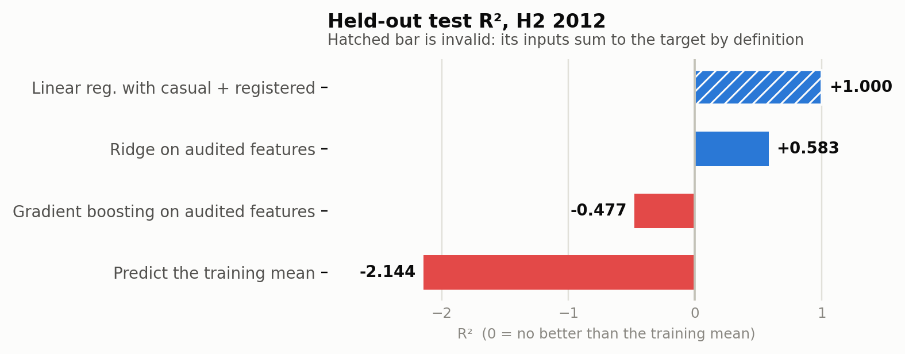

# Agentic Programming (Tutorial + Assignment)

Agents can do a lot of the routine work in a capstone project. They read your code, write new code, run it, and fix errors. Tasks that took a week can take an afternoon.

What an agent does not know is what your result is supposed to mean. It stops when the code runs and the output looks reasonable. A pipeline can run without errors, report a high score, and still be answering the wrong question.

This tutorial does two things. First it shows how to build an agent: giving it standing instructions, choosing which tools it can use, packaging a workflow it can repeat, adding a second agent to review its work, and writing your own agent in Python with the Agent SDK. Then it shows how to build checks into that agent, so it has to pass them before the work counts as done.

You will do this on one example: forecasting daily bikeshare demand, from a dataset with a leakage trap in it. The checks are a test that fails if a leaked column reaches the model, a split that respects time order, and two baselines reported with every score. These are what let you defend the result in your report.

| **Background Needed** |  Comfortable with Python, pandas, and scikit-learn. No prior agent experience assumed. |
|---|---|
| **Running example** | Forecasting daily bikeshare demand — a small, time-series problem with a leakage trap built into the data. |
| **You will need** | Claude Code installed, Python 3.11+, and about 400 MB of disk. Setup commands are in Appendix A. |
| **What you will build** | A working agentic repo with a verification loop, a hook, a subagent, a skill, and a batch auditor. |
| **[Starter code](./assets/bikeshare-starter.zip)** | `bikeshare-starter.zip` — the finished reference repo from Steps 1–8, with generated outputs stripped. Work through the steps against it so you understand *why* each file exists. |
| **What you submit** | One git repository built on the starter: the starter as its first commit, plus the files listed under **What you submit** in Part 5 — a `REPORT.md`, a new feature with its test, `docs/SEEDED_FAULTS.md`, `docs/AUDIT.md`, a skill of your own, and the committed metrics and audit output. |

## Lesson outline

#### A. The agentic loop and its failure mode

- What an agent actually does: read, act, observe, repeat — and why the loop stops when the work merely looks done.
- Context as the binding constraint. Why performance degrades as context fills, and why /clear between unrelated tasks outperforms one long heroic session.
- The trust-then-verify gap: plausible code that fails on cases nobody enumerated.

#### B. Specification before generation

- Plan mode as the separation of research from execution.
- Letting the agent interview you, then writing SPEC.md, then starting a fresh session to execute it.
- CLAUDE.md as the project's standing constraints — and the failure mode of writing too much in it.

#### C. Verification as the unit of methodology

- The central move: **every claim becomes a check.** "We avoided leakage" becomes a test that fails if a forbidden column enters the feature set.
- Tests, baselines, and assertions as the agent's stopping condition rather than your attention.
- Adversarial review in a fresh context: why the model that wrote the code should not be the one grading it.

#### D. Structural guarantees

- Hooks: deterministic, non-negotiable, run every time. Where they beat instructions.
- Permissions and sandboxing: allowlists, denylists, and protecting raw data from modification.
- Subagents: isolated context for research and for review.
- Skills: packaging a workflow so the twelfth feature is added the same way as the first.

#### E. Building your own agents

- Claude Code versus the Agent SDK: the same engine, a different harness.
- Custom tools — giving deterministic work to code and judgement to the model.
- Structured output, concurrency, and failure handling in a batch run.

#### F. Research integrity

- Attribution: what the agent did, what you decided, and how the report should say so.
- Reproducibility: seeds, pinned versions, and a pipeline that runs from one command.
- Whether the question is worth asking, and whether the answer is believable.

## Part 1 · Why methodology changes

For most of your degree, writing the code was the slow step. You thought carefully before you coded. That constraint quietly enforced a lot of methodology: you did not try forty feature sets because forty feature sets was a week of work.

That constraint is gone. An agent will try forty feature sets in an afternoon. What it will not do is notice that thirty-nine of them were invalid for a reason nobody wrote down.

The bottleneck has moved from *producing* analysis to *trusting* it. Everything in this tutorial follows from this.

**The running example**

We forecast daily bikeshare ridership in Washington, DC for 2011–2012 (Fanaee-T and Gama; the canonical copy lives at UCI). Each row is one day: weather, calendar context, and three count columns — casual riders, registered riders, and cnt, the total.

We do not use the UCI file directly. The pipeline downloads a processed mirror (the copy distributed with Molnar's *Interpretable Machine Learning*), and the mirror differs from UCI in ways that matter for this lesson: 728 rows starting 2011-01-03 rather than 731 from 2011-01-01, one day dropped in the middle, weather as text labels rather than codes 1–4, and two extra columns. `src/config.py` lists every difference. If you pull the UCI file yourself, Step 5 will not go the way this page says it does.

**The trap:** `casual + registered == cnt` exactly, on every row. A model handed those two columns achieves a perfect score by learning addition. It forecasts nothing, because at prediction time you would not know either input: they are components of the very quantity you are trying to predict.

A second, subtler problem sits underneath: ridership grew about 65% from 2011 to 2012. Any honest evaluation must therefore predict a future that does not look like the past — which turns out to matter more for model choice than anything about hyperparameters.

### Where we end up

This is the result the tutorial produces. Read it before you start, so you know what you are working toward.



Test-set R² in the second half of 2012, after training in 2011: the leaky demo from Step 3 (hatched), plus the two baselines and two models in reports/metrics.json, produced by make all. R² is computed against the test-period mean, so 0 means "as good as a constant nobody could have known in advance".

Four things in that chart are worth more than a lecture:

1. **The perfect score is the invalid one.** R² = 1.000 is not an achievement; it is the signature of leakage.
1. **The mean baseline scores −2.1.** Predicting the 2011 average for every day in late 2012 is much worse than useless, because the distribution moved. Without that number on the page, +0.58 is uninterpretable.
1. **Persistence scores +0.51.** "Predict yesterday's count" is the baseline that can embarrass a model built on lagged demand, and it nearly does: ridge beats it by 0.07 R² and loses to it on MAE (947 vs 840 rides). That caveat belongs in the report, not in a footnote.
1. Gradient boosting loses to ridge though it still beats the mean baseline, so the two red bars are negative for different reasons. A tree cannot predict a value outside the range it saw in training, and more than half of the test days (56%) are above the 2011 maximum.

> **This is the shape of a good data science pipeline project finding.** Not "our model achieved R² = 0.58" but "the naive evaluation gives 1.000 and is invalid; under a temporal split the mean baseline is strongly negative, a linear model reaches 0.58 against a persistence baseline of 0.51, and gradient boosting fails because it cannot extrapolate a growing trend." The second version is a result. The first is a number.

## Part 2 · The five primitives

Claude Code gives you five places to put knowledge. Choosing correctly among them is most of the skill. The distinction that matters most is the third column: instructions can be ignored; hooks cannot.

| **Primitive** | **Lives in** | **Enforcement** | **Use it for** |
|---|---|---|---|
| **`CLAUDE.md`** | Project root | Advisory | Standing constraints that apply to every session: commands, forbidden columns, the split rule. Loaded every time, so keep it short. |
| **Plan mode** | Shift+Tab | Session-scoped | Separating exploration from execution. The agent reads and reasons but cannot edit. |
| **Skills** | .claude/skills/<name>/SKILL.md | Advisory, on demand | Workflows you repeat: adding a feature, running an ablation, writing a weekly update. Loaded only when relevant, so they can be long. |
| **Subagents** | .claude/agents/<name>.md | Isolated context | Research that would flood your context, and review that must not be done by the author. |
| **Hooks** | .claude/settings.json | Deterministic | Guarantees. A hook runs every time, whatever the agent intends. This is where methodology stops being a request. |

Two caveats on "deterministic". A hook always *runs*; what it can *prevent* depends on when it fires — a `PostToolUse` hook sees an edit that has already landed, a `PreToolUse` hook can refuse one, and a `Stop` hook can refuse to let the agent call the work finished. And permission rules bind tool calls, not the world: denying `Write` to `data/raw/` stops the Edit tool, not a `cp` inside a Bash command. Know what each guarantee actually covers before you lean on it.

### The rule of thumb

If forgetting it would invalidate a result, it is a hook or a test. If forgetting it would waste an hour, it is CLAUDE.md or a skill. **Do not put load-bearing methodology in prose.**

### Prompting, briefly

Prompting matters less than people think and less than the repository you prompt inside. But three habits pay for themselves immediately.

| **Habit** | **Weak** | **Strong** |
|---|---|---|
| State the check | "Build a demand model." | "Build a demand model. Report validation R² against the mean and persistence baselines and run make test before you tell me it works." |
| Name the source | "Why is the data weird?" | "Read src/ingest.py and data/raw/bike\_daily.csv, then tell me which columns have unexpected label values." |
| Say what is out of scope | "Improve the model." | "Improve validation R² by changing features only. Do not touch the split, the baseline, or reports/." |

> **Have the agent interview you.** For anything larger than a single change, start with: "I want to build X. Interview me in detail using the AskUserQuestion tool. Ask about edge cases and tradeoffs I might not have considered. Then write a complete spec to SPEC.md." Then open a fresh session to execute the spec. The interview surfaces decisions you were about to make by accident.

## Part 3 · The tutorial

Eight steps. Each one gives you the prompt to type, what should happen, and why it is the methodological point rather than a keystroke. Run them in order; the bugs in Step 5 only appear because of the choices in Step 4.

Appendix A has the setup.

### Step 1 · Give the project standing constraints

Create the project directory, initialise git, and start Claude Code in it. Then:

```text
/init
```

This generates a starter CLAUDE.md. It will be generic, because the project is empty. Replace it with constraints the agent could not infer — which, at this stage, means the constraints you already know from the data dictionary.

```
# Bikeshare demand dataset

Daily Capital Bikeshare counts, 2011-2012. We forecast `cnt` (total daily
rides) from calendar, weather, and lagged-demand features.

## Non-negotiable rules
- **Never** put `casual` or `registered` in a feature set:
  `casual + registered == cnt` exactly. `src/config.py` lists these and
  the other excluded columns with the reason for each.
- **Never** split this data randomly. Use `src.train.temporal_split`.
  Train = 2011, valid = H1 2012, test = H2 2012. Never tune on test.
- Report the mean baseline and the persistence baseline (yesterday's
  count) alongside every model score.
```

The starter repo's `CLAUDE.md` is this plus a Commands section, a Style section, and a Gotchas section — about 40 lines. That is roughly the ceiling.

**Why is this the first step?** You are writing down what you know before the agent has a chance to guess. Everything in that file is a decision you made as the researcher; none of it is derivable from the code, because there is no code yet. Run `/context` to confirm it is loaded.

> **Keep it short.** A bloated CLAUDE.md is worse than a short one — important rules get lost in noise and the agent starts ignoring the file. For each line, ask: would removing this cause a mistake? If not, cut it. Domain knowledge that is only sometimes relevant belongs in a skill, which loads on demand.

### Step 2 · Explore and plan, without writing code

Enter plan mode (`Shift+Tab` until the status bar reads `plan mode on`, or start with `claude --permission-mode plan`). The agent can read and run read-only commands, but cannot edit.

```text
Download the daily bikeshare CSV from the URL in README.md into
data/raw/. Then characterise it for me: row count, date range, every
column with its dtype and distinct values if categorical, and any
missing dates in the calendar. Do not build features or models yet.

Then tell me specifically: which columns could leak the target, and
what would go wrong if I split this data randomly?
```

Read the answer carefully — this is the one moment in the session where the agent is doing research rather than production, and its output is an input to your judgement rather than a deliverable.

Expect it to find: 728 rows spanning 2011-01-03 to 2012-12-31; a weather column with the labels GOOD, MISTY and BAD (463 / 245 / 20 days); and one absent calendar day, 2011-03-10. It should identify casual and registered as leakage. It may or may not spot the missing day, which is exactly why you asked.

It will probably also flag `cnt_2d_bfr`. Press it on *why*. That column is the count from two days earlier — a quantity you would know at prediction time, so it is a lag feature, not leakage. We still exclude it, for a different reason: we did not build it, so we cannot test how it was aligned. The distinction matters, and an agent that lumps everything suspicious under "leakage" has not understood the problem. `src/config.py` keeps the three reasons for excluding a column in three separate sets.

**Why this is separate from Step 3.** Letting an agent jump to code produces code that solves the wrong problem, confidently. Plan mode is cheap insurance. Press `Ctrl+G` to open the plan in your editor and change it before approving — the plan is yours, not the agent's.

> **Planning has a cost.** Do not use plan mode for a typo or a log line. It earns its keep when the approach is uncertain, the change spans several files, or you do not yet know the data. If you could describe the diff in one sentence, skip it.

### Step 3 · Ask naively, and get the answer you deserve

Leave plan mode. Now ask the way a hurried student would ask — this is a deliberate demonstration, so type it exactly:

```text
Build a model to predict cnt from the other columns. Report R-squared.
```

The agent will drop the target, use everything else, split the data, fit a model, and report something close to a perfect score. Ours reports:

```
Features: ['casual', 'registered', 'temp', 'hum']
Test R^2 = 1.000000
```

**Stop here and sit with it.** Nothing went wrong mechanically. The agent did exactly what you asked, the code has no bugs, the score is real, and the result is worthless. There is no prompt phrasing that reliably prevents this, because the problem is not in the prompt — it is that the correctness criterion existed only in your head.

> **The reflex to build.** A result substantially better than you expected is a bug report until proven otherwise. In a capstone, the moment you see a number you would be thrilled to put in the report is the moment to go looking for the reason it is wrong. Train this reflex now; it is the most useful thing in this lesson.

Ask the agent to explain its own result:

```text
Check whether any subset of the features you used is an exact linear
combination of cnt. Show me the residual, not your reasoning.
```

It will find that casual + registered reproduces cnt to within floating-point error. Good — now make that finding permanent.

### Step 4 · Turn the finding into a test

This is the pivot of the whole lesson. A lesson the agent learned in conversation is gone when you clear the context. A lesson written as a test runs forever.

```text
Write tests/test_leakage.py. It must fail if any forbidden column
reaches the feature set. Include a test that documents WHY: assert that
casual + registered == cnt on every row.

Also add src/config.py with a LEAKAGE_COLS set as the single source of
truth, and have the feature builder derive its column list by excluding
that set so the builder and the tests read the same definition.

Run the tests and show me the output. Do not build the model yet.
```

The design instruction in the middle is the important one. One named constant feeds both the feature builder and the tests, so the two cannot drift apart. Be clear about what it does not buy you: a denylist admits a new column silently, because nobody thought to forbid it, while an allowlist drops one silently instead. Pick the failure you would rather have, and write it down. You are specifying a mechanism, not just an outcome.

```
# src/config.py

# 1. Leakage: the target or an arithmetic restatement of it.
LEAKAGE_COLS = {"casual", "registered", "cnt"}

# 2. Time indexes: not leakage, but a bad bet. A tree splits on "after
#    date X" and predicts a flat constant for every future date; a linear
#    model extrapolates a two-year trend we have no reason to trust.
TIME_INDEX_COLS = {"instant", "yr", "days_since_2011"}

# 3. Unverified: a two-day lag that shipped with the mirror. Known at
#    prediction time, so not leakage -- but we cannot test how it was
#    aligned, so we build our own lags and test those.
UNVERIFIED_COLS = {"cnt_2d_bfr"}

# What feature_columns() and the tests actually enforce.
FORBIDDEN = LEAKAGE_COLS | TIME_INDEX_COLS | UNVERIFIED_COLS
```

```
# tests/test_leakage.py
from src.config import FORBIDDEN, TARGET
from src.features import feature_columns

def test_leakage_identity_holds(feats):
    """Documents *why* casual and registered are forbidden."""
    assert (feats.casual + feats.registered == feats[TARGET]).all()

def test_no_forbidden_features(feats):
    cols = set(feature_columns(feats))
    assert not (cols & FORBIDDEN), f"forbidden columns: {cols & FORBIDDEN}"
```

Why the identity test earns its place. It documents the reason, so a teammate in week eight who wonders why two perfectly good columns are banned gets an answer. Be precise about what its neighbour does, though: `test_no_forbidden_features` asserts a property `feature_columns` already guarantees by construction, so it will never catch a new leaky column in the data. What it catches is someone editing `feature_columns` or `FORBIDDEN`, which is exactly the failure the hook in Step 7 demonstrates.

### Step 5 · Rebuild features under the contract

Now let the agent build the modelling table, with the tests in place as its stopping condition.

```text
Write src/features.py. Calendar features, a cyclical month encoding,
an ordinal weather severity, and lagged demand: cnt_lag_1, cnt_lag_7,
and a 7-day rolling mean.

Constraints: every aggregation shifts before it aggregates, so no
feature contains information from its own day. Run make test after
each change and show me the failures before you fix them.
```

**The last sentence matters.** "Show me the failures before you fix them" turns a silent self-correction loop into a visible one. You want to see what broke, because two of the breaks are real findings about the data.

#### Bug 1 — the calendar has a hole

The lag test compares cnt\_lag\_1 on date d against cnt on d−1 in calendar terms, and it fails. The mirror is missing 2011-03-10: the UCI row for that day records a humidity of 0, a sensor artefact, and the mirror's cleaning dropped the whole day. (Hurricane Sandy, 2012-10-29, is present — 22 rides, in the test set. Expect it in your residual plot.) pandas .shift(1) moves by rows, not by days, so across that gap the row after it gets a two-day lag labelled as a one-day lag.

Be precise about the blast radius, because the agent will overstate it. The rows after the gap are *not* all wrong: a row-shift realigns with the calendar as soon as it has passed the hole. What is wrong is `cnt_lag_1` on the one day after the gap, `cnt_lag_7` on the one day a week after it, and the 7-day rolling mean for the seven days in between — about eight rows, each wrong by one day, and nothing in the data announces any of it. Small, silent, and exactly the kind of thing a test finds and a glance does not.

```
def reindex_to_calendar(df: pd.DataFrame) -> pd.DataFrame:
    """Insert a row for every missing calendar day.

    Without this, shift(1) becomes a two-day lag across the gap and
    nothing in the data announces it.
    """
    full = pd.date_range(df.dteday.min(), df.dteday.max(), freq="D")
    return df.set_index("dteday").reindex(full).rename_axis("dteday").reset_index()
```

After reindexing, the gap is an explicit NaN that `dropna()` removes along with the rows whose lags depend on it. Every lag then means what it says.

#### Bug 2 — a silent .map() eats 20 rows

The weather encoder was written against the UCI documentation, which describes four numeric codes. This mirror uses the labels GOOD, MISTY and BAD. Every BAD day maps to NaN and is then deleted by a downstream dropna, no error, no warning, twenty of the most interesting days in the dataset simply gone.

```
def encode_weather(series: pd.Series) -> pd.Series:
    """Ordinal-encode weather, failing loudly on unseen labels."""
    unknown = set(series.dropna().unique()) - set(WEATHER_ORDER)
    if unknown:
        raise ValueError(f"unmapped weather labels: {sorted(unknown)}")
    return series.map(WEATHER_ORDER).astype(float)
```

Then add the test that would have caught it without you looking:

```
def test_only_expected_rows_are_dropped(raw, feats):
    """Rows may only vanish for the lag warm-up or downstream of a genuinely
    absent day -- never because an encoder produced a silent NaN."""
    full = pd.date_range(raw.dteday.min(), raw.dteday.max(), freq="D")
    missing_days = len(full) - len(raw)
    allowed_loss = LAG_WARMUP + LAG_WARMUP * missing_days   # 7 + 7 * 1 = 14
    lost = len(raw) - len(feats)
    assert lost <= allowed_loss, f"lost {lost}; expected at most {allowed_loss}"
```

Do the accounting rather than guessing the constant. The first seven days have no complete history. Each absent day *m* costs the seven rows after it: `cnt_lag_1` is NaN on *m*+1, `cnt_roll_7` is NaN on *m*+1 through *m*+7, and `cnt_lag_7` on *m*+7 — their union is seven rows. Day *m* itself was never in `raw`, so it is not a loss. 728 raw rows become 714, the bound is exactly 14, and a silent encoder that eats twenty more rows cannot hide. `LAG_WARMUP` lives in `src/config.py` so that a future 14-day feature has one place to change and the test tracks it.

> **Neither bug is about agents.** You could have written both by hand. The point is that at agent speed you would have shipped both, because the pipeline runs green and the numbers look plausible. The tests are what make the speed safe.

### Step 6 · Split by time, and report the baseline

```text
Write src/train.py: split by date (train 2011, valid H1 2012, test
H2 2012), fit a mean baseline, a persistence baseline (predict
cnt_lag_1), a standardised ridge, and a gradient booster, and write
reports/metrics.json.

Report valid and test R-squared and MAE for all four. Do not tune
anything against the test set.
```

```
{
  "baseline_mean":        {"valid": {"r2": -0.9318, "mae": 2002.2}, "test": {"r2": -2.1441, "mae": 2847.7}},
  "baseline_persistence": {"valid": {"r2":  0.4507, "mae":  900.6}, "test": {"r2":  0.5099, "mae":  840.1}},
  "ridge":                {"valid": {"r2":  0.6475, "mae":  832.9}, "test": {"r2":  0.5833, "mae":  947.1}},
  "hgb":                  {"valid": {"r2":  0.2185, "mae": 1296.6}, "test": {"r2": -0.4975, "mae": 1972.6}}
}
```

(These are the numbers with the versions pinned in `requirements.txt`. The ridge and baseline rows are stable across scikit-learn releases; the `hgb` row drifts by a few hundredths between versions, which is itself a small lesson about why deliverable 1 asks you to pin.)

Now ask the question the numbers demand:

```text
Gradient boosting beats the mean baseline on both splits, but falls
from 0.22 on validation to −0.50 on test, while ridge holds at 0.65
and 0.58. Explain the mechanism, and show me the evidence — compare
the range of cnt in train against test.
```

The answer is that a tree predicts by averaging training targets in a leaf, so it cannot produce a value above the maximum it has seen. The 2011 maximum is 6,043 rides; ridership grew 65%, and 56% of the test days are above that ceiling. Ridge extrapolates through its lag coefficients and survives. (Out-of-range targets do not explain the weak *validation* score — H1 2012 is largely within range. Three hundred and forty-eight training rows and default boosting settings do. Ask the agent about that too; it will reach for the tidy explanation first.)

Then ask the question the agent will not volunteer:

```text
Ridge beats persistence by 0.07 R-squared on test and loses to it on
MAE. Is ridge actually learning anything beyond "yesterday again"?
Show me the ridge coefficients on the standardised features.
```

Persistence is the baseline that matters here, because ridge's inputs are dominated by lagged demand. It is in the table so that "0.58" is read as "0.07 better than doing nothing clever", which is the honest size of the result.

**This is your headline result**, and you only have it because the baselines and the temporal split were in place before the modelling started. Reversed — model first, evaluate later — this looks like a tuning problem and you spend a week on hyperparameters.

### Step 7 · Make the guarantee structural

Tests only help if they run. A hook runs them whether or not anyone remembers.

```text
Write a PostToolUse hook that re-runs tests/test_leakage.py whenever
a file under src/ is edited, and exits 2 with the failure output on
stderr if they fail.

Read the hook input from stdin as JSON -- CLAUDE_FILE_PATHS is not a
real environment variable. Then test the hook three ways: a src edit
with tests passing, a non-src edit, and a src edit with the guard
deliberately broken.
```

```
{
  "hooks": {
    "PostToolUse": [{
      "matcher": "Edit|Write",
      "hooks": [{
        "type": "command",
        "command": "${CLAUDE_PROJECT_DIR}/.claude/hooks/check_leakage.sh",
        "timeout": 60,
        "statusMessage": "Re-running leakage tests..."
      }]
    }]
  },
  "permissions": {
    "allow": ["Bash(make:*)", "Bash(python -m pytest:*)"],
    "deny": ["Write(./data/raw/**)", "Edit(./data/raw/**)", "Bash(rm -rf:*)"]
  }
}
```

Exit code 2 is the whole mechanism: stderr goes back to the agent as a system message, so the failure is in front of it immediately and it cannot carry on as if the edit were fine. Be exact about what this guarantees. `PostToolUse` fires *after* the edit has landed, so the hook does not prevent a bad edit; it makes a bad edit impossible to ignore. That is the right trade here — you cannot run the tests against an edit that has not happened yet — but if you want "done" itself to be conditional on green tests, add a `Stop` hook that runs `make test` and exits 2 on failure (check `stop_hook_active` in the payload so it cannot loop). Exercise 2 has you break the pipeline and watch which hook catches what.

The `deny` rules encode a rule you should adopt for every project: raw data is immutable. Anything that needs changing gets changed downstream, in code, where it is reviewable. Note what they bind: tool calls. `Edit(./data/raw/**)` stops the Edit tool; it does not stop `cp` inside a Bash command, and `Bash(rm -rf:*)` is matched by prefix, so `rm -r -f` walks past it. Permission rules are a boundary for the agent's hands, not a sandbox. If you need a sandbox, use the filesystem — `chmod -w data/raw` — or git.

#### An adversarial reviewer

The model that wrote the code is a poor judge of it. A subagent runs in its own context, sees the diff and the criteria but not the reasoning that produced them, and evaluates on its own terms.

```
---
name: leakage-auditor
description: Audits a diff for target leakage, temporal-split violations,
  and unreported baselines. Use before committing to src/.
tools: Read, Grep, Glob, Bash
model: opus
---
You are a methodology reviewer for a time-series forecasting repo. You
did not write this code and you have no stake in it being correct.
[... five explicit checks ...]
Verify each claim by reading the code or running it. Do not accept a
docstring as evidence that behaviour is correct.
Report only findings that change a number or invalidate a conclusion.
```

> **Tell the reviewer what not to report.** A reviewer asked to find gaps will find some, whether or not they exist, because that is the job it was given. Without "report only findings that change a number," you get style opinions and defensive abstractions. Over-engineering is the failure mode of unconstrained review.

### Step 8 · Package the workflow as a skill

You will add features for the next eight weeks. The twelfth should be added exactly like the first, including the parts that are tedious.

```
---
name: new-feature
description: Add a feature column with its leakage test. Use whenever
  someone asks to add, engineer, or try a new predictor.
allowed-tools: Read, Edit, Bash(python -m pytest*), Bash(make*)
---
# Current feature set
!`python -c "...print the live feature list..."`

# Adding a feature: $ARGUMENTS
1. State the availability argument in one sentence. At prediction time
   for date d, is every input known? If not, say so and stop.
2. Write the failing test FIRST in tests/test_leakage.py. Confirm it
   fails for the right reason.
3. Implement it after reindex_to_calendar. Shift before you roll.
4. Verify: make features && make test && make train. Report the
   before/after VALIDATION R2. Never report test numbers while iterating.
5. Record the decision in docs/DECISIONS.md.

If validation R2 improves by less than 0.01, say so plainly and
recommend dropping the feature. The validation set is 182 days; a
change that small is inside the noise, not a gain.
```

**Two details worth stealing.** The `!`command`` syntax runs a shell command and injects its output before the agent reads the skill, so step 1 starts from the live feature list rather than a remembered one. And the last paragraph gives the agent permission to report a null result — without it, an agent asked to add a feature will add a feature. (The 0.01 threshold is a floor on what is worth discussing, not a significance test. With 182 validation days the noise in R² is larger than that, which is one more reason the test set is touched once.)

Invoke it with /new-feature humidity interaction, or just describe what you want and let it trigger on its own.

## Part 4 · Graduating to the Agent SDK

Everything so far happened inside Claude Code, with you watching. The Agent SDK is the same engine with a different harness: you write the loop, in Python, and the agent becomes a component of a program rather than a conversation.

### When to switch

| **Stay in Claude Code when…** | **Reach for the SDK when…** |
|---|---|
| You are the one reading the output. | A program is reading the output, and it needs a schema. |
| The task happens once, or a few times. | The task happens forty times, or nightly. |
| You want to redirect mid-task. | Nobody is there to redirect anything. |
| The tools you need already exist. | You need a deterministic tool the model should not attempt by reasoning. |

Our case is the third and fourth rows at once. The leakage-auditor subagent is exactly the right reviewer; we simply need to run it across every repo in the class and get back a row per repo.

### Custom tools: give the deterministic part to code

Deciding whether three float columns sum to a fourth is not a judgement call — it is least squares, and `numpy` is perfect at it while a language model is unreliable. Define it as a tool and let the model decide when to call it.

```
from claude_agent_sdk import tool, create_sdk_mcp_server

@tool("check_identity",
      "Test whether any subset of candidate columns is an exact linear "
      "restatement of the target. Returns the offending subsets.",
      {"csv_path": str, "target": str, "candidates": list})
async def check_identity(args):
    df = pd.read_csv(args["csv_path"])
    cols = [c for c in args["candidates"]
            if c in df.columns and c != args["target"]]

    hits = []
    for r in (1, 2, 3):
        for subset in combinations(cols, r):
            block = df[list(subset) + [args["target"]]].dropna()
            # Intercept column, so cnt = a*x + b is caught as well as
            # cnt = casual + registered. lstsq on NaN returns garbage
            # rather than raising, hence the dropna.
            X = np.column_stack([block[list(subset)].to_numpy(dtype=float),
                                 np.ones(len(block))])
            y = block[args["target"]].to_numpy(dtype=float)
            coef, *_ = np.linalg.lstsq(X, y, rcond=None)
            resid = float(np.abs(X @ coef - y).max())
            if resid < 1e-6:
                hits.append({"columns": list(subset), "max_residual": resid})

    verdict = "LEAKAGE" if hits else "clean"
    return {"content": [{"type": "text",
            "text": json.dumps({"verdict": verdict, "identities": hits})}]}

auditor_tools = create_sdk_mcp_server(
    name="audit", version="1.0.0", tools=[check_identity])
```

Run against our own data, it returns exactly what it should:

```
{"verdict": "LEAKAGE",
 "identities": [{"columns": ["casual", "registered"],
                 "max_residual": 1.8e-12}, ...]}
```

### The loop

```
REPORT_SCHEMA = {            # the JSON the auditor must return; full version in agent/audit.py
    "type": "object",
    "properties": {
        "leakage": {"type": "string", "enum": ["none", "suspected", "confirmed"]},
        "temporal_ok": {"type": "boolean"},
        "baseline_reported": {"type": "boolean"},
        "reproducible": {"type": "boolean"},
        "findings": {"type": "array", "items": {...}},
        "confidence": {"type": "string", "enum": ["low", "medium", "high"]},
    },
    "required": [...],
}

async def audit_repo(repo: Path) -> dict:
    options = ClaudeAgentOptions(
        system_prompt=SYSTEM,          # the four checks
        cwd=str(repo),
        mcp_servers={"audit": auditor_tools},
        allowed_tools=["Read", "Grep", "Glob", "Bash",
                       "mcp__audit__check_identity"],
        permission_mode="default",     # anything not in allowed_tools is denied
        max_turns=40,
        model="claude-sonnet-4-6",
        output_format={"type": "json_schema", "schema": REPORT_SCHEMA},
    )
    final = None
    async for message in query(prompt=f"Audit the repo at {repo}.",
                               options=options):
        if isinstance(message, ResultMessage):
            final = message            # only the last message is the answer

    if final is None or final.is_error:
        return {"repo": repo.name, "error": "run_failed"}
    if final.structured_output is not None:
        return {"repo": repo.name, **final.structured_output}
    try:                               # fallback if schema enforcement is unavailable
        return {"repo": repo.name, **json.loads((final.result or "").strip())}
    except json.JSONDecodeError:
        # Never let one malformed reply kill a 40-repo run.
        return {"repo": repo.name, "error": "unparseable", "raw": (final.result or "")[:500]}
```

Two things in that loop are easy to get wrong. Only the `ResultMessage` carries the final answer; concatenating every intermediate `TextBlock` ("Let me look at config.py first...") and `json.loads`-ing the lot fails on the first repo where the agent thinks out loud. And `output_format` with a JSON schema is a contract the SDK enforces, which "reply with only JSON" in the prompt is not — keep the `try` anyway, because a contract can still be broken by an error.

Then bound the concurrency and write one JSON object per line, so the output is a dataframe:

```
sem = asyncio.Semaphore(args.concurrency)   # args from argparse; default 4

async def bounded(repo):
    async with sem:
        return await audit_repo(repo)

results = await asyncio.gather(*(bounded(r) for r in args.repos))
with args.out.open("w") as fh:
    for row in results:
        fh.write(json.dumps(row) + "\n")
```

### Three things that separate a working batch agent from a demo

1. **Constrain the output with a schema, then parse defensively anyway.** `output_format` makes the shape a contract. The `try` around the fallback is for the runs where the contract could not be honoured. One failed reply must not lose the other thirty-nine results.
1. **Scope the tools.** allowed\_tools is a security boundary, not a hint. An auditor needs to read and run; it never needs to write, so do not hand it a permission mode that could grant edits. Remember that `Bash` is on the list: the auditor runs student code. Run it somewhere you would be happy for student code to run.
1. **Bound the concurrency.** A semaphore around gather keeps you inside rate limits and makes the run reproducible enough to debug.

> **The honest limitation.** A batch auditor is a screening instrument, not a verdict. It reliably surfaces exact identities, random splits, and missing baselines. It will not tell you whether the research question was worth asking. Use it to decide where to spend your attention, never to replace it.

## Part 5 · What this means for your assignment

### What you submit

You submit **one git repository**, built on the starter. Unzip `bikeshare-starter.zip`, run `git init`, and make the unmodified starter your first commit, so that `git diff <first-commit>` shows exactly what you added. We grade that diff and the repo it produces. Submit the repository URL through the course submission form.

The starter already contains the finished pipeline from Steps 1–8. The assignment is not to rebuild it; it is to extend it, break it, audit it, and write up what you found, with the agent doing the typing and you doing the deciding. Every file you must add or change is listed below, by path. A file not on this list is not graded; a file on this list that is missing costs the points of the rubric item it serves.

| Path | Add / modify | What it must contain | Rubric |
|---|---|---|---|
| `REPORT.md` | **Add** | Your write-up, 2–4 pages of Markdown, in exactly these five sections: **Results**, **Headline finding**, **Exercise 4 — target transformation**, **Exercise 5 — ridge vs persistence**, **Attribution**. Details under each rubric item below. | 4, 7 |
| `src/features.py` | **Modify** | One new feature you added through `/new-feature` (Exercise 1). Built after `reindex_to_calendar`, shifted before any aggregation. If it needs more than 7 days of history, `LAG_WARMUP` in `src/config.py` changes with it. | 3, 4 |
| `tests/test_leakage.py` | **Modify** | One new test for that feature, asserting its value on a named date equals the hand-computed value from strictly earlier dates. Written before the feature, and the failing run recorded in `docs/SEEDED_FAULTS.md`. | 3 |
| `tests/test_contract.py` | **Modify** | One new test of your own that flags any column in `data/raw/bike_daily.csv` not classified in `src/config.py` (not in `FORBIDDEN`, not a feature, not `dteday`), so a new column in the data cannot enter silently. | 3 |
| `docs/DECISIONS.md` | **Modify** | The five starter lines kept, plus one line per decision you made: your feature (with its availability argument and validation delta), whether you kept it, your Exercise 4 transformation and whether it is defensible, and anything you changed in `CLAUDE.md`. Dated, newest last. | 7 |
| `docs/SEEDED_FAULTS.md` | **Add** | Exercise 2. For each of three seeded faults — a forbidden column added to `feature_columns`, the `.shift(1)` deleted from `cnt_roll_7`, and the weather encoder's `raise` removed — the exact change, the red test output, the hook's stderr, and how many turns the agent needed to fix it. Then the fourth fault the hook cannot see (a `cp` into `data/raw/` from Bash): what happened, and what would have caught it. Paste real output, not a description of it. | 3, 5 |
| `docs/AUDIT.md` | **Add** | Exercise 3. The repository you audited (a teammate's URL), the `/leakage-auditor` output verbatim, and your own one-paragraph verdict on which findings change a number. If it found nothing, say so and show the run. | 6 |
| `reports/audit.jsonl` | **Add** | Part 4. The output of `python agent/audit.py . --out reports/audit.jsonl` run against your own finished repo: one JSON line. If the auditor flags your repo, either fix it or explain in `REPORT.md` why it is wrong. | 6 |
| `reports/metrics.json` | **Add** | Committed, from `make all` on your final code, with both baselines and both models. Remove `reports/` from `.gitignore` to commit it. Your `REPORT.md` table must match it to the printed digit. | 1, 4 |
| `.claude/skills/<name>/SKILL.md` | **Add** | One skill you authored, for a workflow you actually repeated during this assignment, taking `$ARGUMENTS`. Candidates: `seed-fault <description>` (break, record, restore), `ablation <feature>` (drop a feature, retrain, report validation delta), `weekly-update <week>`. Keep the starter's `new-feature` skill; it is not yours. | 6 |
| `CLAUDE.md` | **Modify** | Updated for your changes: your new feature's rule if it has one, the skill you added, anything you removed. Still under 60 lines. If you changed nothing, say why in `docs/DECISIONS.md`. | 2 |
| `.gitignore` | **Modify** | `reports/` removed so `metrics.json` and `audit.jsonl` are tracked. `data/processed/`, `.venv/`, caches stay ignored. | 1 |

Keep every other starter file. Do not commit `data/processed/`, `.venv/`, `__pycache__/`, or `.pytest_cache/`. Do not modify `data/raw/bike_daily.csv`; the starter's permission rules deny the agent that, and we check the file's hash (`sha256` begins `a6bed1577f6e4de5`).

**Minimum commit history.** At least these commits, in order, so attribution can be cross-checked: the unmodified starter; the failing test for your feature; the feature that makes it pass; each seeded fault and its fix (or one commit per fault with the fix in the message); the audit run; the report. Squashing everything into one commit scores zero on deliverable 7.

### Deliverables and grading

Seven deliverables, graded out of 100. Each carries its own check, and most of those checks are things we run rather than things we read. Build the repository so a wrong answer cannot pass quietly, and the rubric mostly takes care of itself. Each item below names the files from the table above that it is graded from.

| # | Deliverable | Points |
|---|---|---|
| 1 | Reproducible repository | 15 |
| 2 | `CLAUDE.md` | 10 |
| 3 | Verification suite | 25 |
| 4 | Results with baselines | 20 |
| 5 | Structural enforcement | 10 |
| 6 | Agent configuration | 10 |
| 7 | Decisions and attribution | 10 |

#### 1. Reproducible repository — 15

**Graded from.** `Makefile`, `requirements.txt`, `reports/metrics.json`, `.gitignore`.

**Must contain.** One command — `make all` — that runs from a clean checkout and
produces the numbers in `reports/metrics.json`. Seeds fixed, dependency versions pinned
in `requirements.txt` (the starter's pins are fine; if you add a package, pin it).

**How it is checked.** We clone the repository fresh, `pip install -r requirements.txt`,
run `make all`, and diff the regenerated `reports/metrics.json` against the committed
one and against the table in `REPORT.md`. Any mismatch is a zero here.

#### 2. `CLAUDE.md` — 10

**Graded from.** `CLAUDE.md`, and its line in `docs/DECISIONS.md` if you left it alone.

**Must contain.** Your project's forbidden columns, the split rule, both baselines, and
the command that reproduces your headline number — all already in the starter — plus
whatever your changes require: a rule for your feature if it has one, the name of your
skill. Under 60 lines, and nothing a reader could derive by reading the code.

**How it is checked.** We read it and count the lines. For each line we ask whether
removing it would change what an agent does. Lines that fail that question cost you
here, because a bloated file is one an agent starts ignoring wholesale. Leaving the
starter's file untouched is acceptable only with a one-line justification in
`docs/DECISIONS.md`.

#### 3. Verification suite — 25

**Graded from.** `tests/test_leakage.py`, `tests/test_contract.py`,
`docs/SEEDED_FAULTS.md`.

**Must contain.** Everything the starter ships (leakage test tied to `FORBIDDEN`,
temporal split tests, row-loss bound), plus your two additions: the test for your new
feature, written first, and the unclassified-column test in `tests/test_contract.py`.
`docs/SEEDED_FAULTS.md` with real pasted output for all four faults.

**How it is checked.** `make test` has to pass. Then we seed our own fault — one of
the three in `docs/SEEDED_FAULTS.md`, or a leaked column renamed to something innocent,
or a new column appended to the raw CSV — and confirm that a test goes red. A suite
that stays green under a seeded fault is not a verification suite. We also check that
the failing output you pasted matches what your tests actually print.

#### 4. Results with baselines — 20

**Graded from.** `REPORT.md` (sections **Results** and **Headline finding**),
`reports/metrics.json`, `docs/DECISIONS.md`.

**Must contain.** In **Results**: one table with validation and test R² and MAE for
`baseline_mean`, `baseline_persistence`, `ridge`, and `hgb`, before and after your
feature — eight rows, matching `reports/metrics.json` exactly. In **Headline finding**:
one paragraph stating the result the way the box in Part 1 does, with the numbers in
it, and one sentence on what your feature changed and whether you kept it.

**How it is checked.** We compare the table to the metrics file, and read
`docs/DECISIONS.md` and your commit history for signs that the test set was consulted
while you were still iterating. A validation delta in `DECISIONS.md` that appears
nowhere in the commits is a flag.

A model that fails to beat its baseline is a finding you report, not a bug you hide.
Note also that negative R² and losing to the baseline are not the same thing — in this
tutorial, gradient boosting is negative on test and still beats the mean baseline
comfortably, while ridge is positive and only narrowly beats persistence. Both facts go
in the report.

#### 5. Structural enforcement — 10

**Graded from.** `.claude/settings.json`, `.claude/hooks/check_leakage.sh`,
`docs/SEEDED_FAULTS.md` (the hook stderr you pasted, and the fourth fault).

**Must contain.** The starter's hook and permission rules, still working. The hook
stderr for each of your three seeded faults, pasted. For the fourth fault — the one the
`PostToolUse` hook cannot see — a paragraph naming what would catch it (a `Stop` hook,
a `PreToolUse` hook on Bash, a filesystem permission, a hash check in `make data`) and,
if you implemented one, the diff. Implementing it is worth up to 3 of the 10 points;
naming it correctly is worth the rest.

**How it is checked.** We edit a file under `src/` to break a test and confirm the hook
fires and the failure reaches the agent. Then we try your fourth fault.

#### 6. Agent configuration — 10

**Graded from.** `.claude/skills/<your-skill>/SKILL.md`, `docs/AUDIT.md`,
`reports/audit.jsonl`.

**Must contain.** One skill you wrote, for a workflow you actually repeated in this
assignment, taking `$ARGUMENTS`, with the starter's `new-feature` skill left in place.
`docs/AUDIT.md` with the `/leakage-auditor` run on a teammate's repository and your
verdict. `reports/audit.jsonl` from running `agent/audit.py` on your own repo.

**How it is checked.** We invoke your skill once with an argument and see whether it
does what its description says. We read `docs/AUDIT.md` for whether you separated the
auditor's findings from your own judgement of them. We check `audit.jsonl` is a real
run (it has the schema's fields and a plausible `findings` list), and that if it
flagged your repo you either fixed it or argued back in `REPORT.md`.

#### 7. Decisions and attribution — 10

**Graded from.** `docs/DECISIONS.md`, `REPORT.md` (section **Attribution**), and
`git log`.

**Must contain.** `docs/DECISIONS.md` with one line per methodological decision: what
you chose, why, and what it changed. The **Attribution** section of `REPORT.md`, in two
lists: files or functions the agent generated, and the decisions that were yours. The
second list is short — what to predict, what counts as leakage, how to split, which
baselines, whether the answer is believable, whether to keep your feature — and every
item on it must trace to a line in `docs/DECISIONS.md`.

**How it is checked.** We read both, cross-checked against your commit history. A
decision with no commit behind it, or a commit with no decision behind it, costs
points here.

#### Two things worth reading twice

**Deliverable 3 is the one that trips up most people.** A leakage test that passes
because it asserts something its own helper already guarantees by construction is a
test that cannot fail. It looks identical to a real check in a green test run. Break
your own pipeline on purpose, keep the failing output, and cite it.

**Reproducibility gates the write-up.** A result we cannot reproduce from a clean
checkout scores zero on deliverables 1 and 4, however good the report is.

### On attribution

Using an agent is expected and needs no apology. Concealing what it did is misconduct. In your report, state plainly which components were agent-generated and which decisions were yours. In practice the second list is the one that matters, and it is short: what to predict, what counts as leakage in your domain, how to split, what the baseline is, and whether the answer is believable.

The sentence to internalise: **the agent is accountable for the code and you are accountable for the claim.** If a number appears in your report, you are asserting it. "The agent generated it" is not a defence, any more than "the library had a bug" would be.

### Exercises

All five are required; each names the file it lands in.

1. **Add one feature** to the pipeline using `/new-feature`. Report the validation delta honestly, including if it is negative, and record the decision. → `src/features.py`, `tests/test_leakage.py`, one line in `docs/DECISIONS.md`, the before/after rows in `REPORT.md` **Results**.
1. **Break things on purpose.** Seed the three faults named in the submission table and confirm a test goes red and the hook fires before you notice. Note how many turns the agent needed to fix each. Then break it in a way the `PostToolUse` hook *cannot* see — a `cp` into `data/raw/` from Bash — and write down what would have caught that. → `docs/SEEDED_FAULTS.md`, with real output pasted.
1. **Audit a teammate.** Run `/leakage-auditor` against a teammate's repository. Report only findings that change a number, and say which of the auditor's findings you agree with. Then run `agent/audit.py` on your own repo. → `docs/AUDIT.md`, `reports/audit.jsonl`.
1. **Argue with the result.** Ridge beats gradient boosting here because of a growth trend. Find a transformation of the target that lets the tree model compete — and then decide whether the transformation is defensible or just a way to win the comparison. Do this on the validation set; touch test once, at the end, and say so. → `REPORT.md` **Exercise 4**, one line in `docs/DECISIONS.md`. Code for the transformation may live in a branch or in `src/train.py` behind a flag, but the committed `reports/metrics.json` is the untransformed pipeline.
1. **Argue with the other result.** Ridge beats persistence by 0.07 R² and loses to it on MAE. Make the case, in one paragraph with numbers, that ridge is worth deploying over "yesterday again" — or that it is not. Either answer can be right; an unargued one cannot. → `REPORT.md` **Exercise 5**.

## Appendix A · Setup

```
# 1. Claude Code
curl -fsSL https://claude.ai/install.sh | bash     # macOS / Linux / WSL
# Windows PowerShell:  irm https://claude.ai/install.ps1 | iex

# 2. Project (unzip the starter, or start empty and build it through the steps)
unzip bikeshare-starter.zip && cd bikeshare-starter && git init
python3 -m venv .venv && source .venv/bin/activate
pip install -r requirements.txt      # pinned; see the note under Step 6

# 3. Start
claude

# 4. For Part 4 only (already in requirements.txt)
pip install claude-agent-sdk
```

The dataset is the daily aggregation of the UCI Bike Sharing Dataset (Fanaee-T and Gama, 2013). The canonical archive at archive.ics.uci.edu blocks some campus networks; the pipeline uses the processed mirror distributed with Molnar's *Interpretable Machine Learning*, recorded in src/config.py along with every way it differs from UCI. A copy is checked in at data/raw/bike_daily.csv so the pipeline runs offline.

### Commands

| **Command** | **Does** |
|---|---|
| `make data` | Download the raw CSV and assert its shape. |
| `make features` | Build data/processed/features.parquet. |
| `make train` | Fit both baselines and both models, write reports/metrics.json. |
| `make test` | Run pytest. 14 tests; all must pass. |
| `make all` | The three pipeline stages in order. |
| `python -m src.leakage_demo` | Reproduce the R² = 1.000 result from Step 3. |

## Appendix B · Repository layout

```
bikeshare-starter/
├── CLAUDE.md                      # standing constraints (Step 1)
├── README.md                      # data source, run instructions
├── Makefile                       # the one command
├── requirements.txt               # pinned versions
├── data/
│   ├── raw/bike_daily.csv         # immutable; writes denied in settings.json
│   └── processed/features.parquet # generated by make features
├── src/
│   ├── config.py                  # paths, FORBIDDEN and its three parts, split dates
│   ├── ingest.py                  # download + shape assertions
│   ├── features.py                # reindex, encode, lag (Step 5)
│   ├── train.py                   # temporal split, 2 baselines + 2 models (Step 6)
│   └── leakage_demo.py            # the R2 = 1.000 demo (Step 3)
├── tests/
│   ├── test_leakage.py            # the contract (Step 4)
│   ├── test_split.py              # temporal ordering, no overlap
│   └── test_contract.py           # calendar completeness, row accounting, baselines
├── agent/
│   └── audit.py                   # batch auditor, Agent SDK (Part 4)
├── docs/DECISIONS.md              # one line per methodological decision
├── reports/metrics.json           # generated by make train
└── .claude/
    ├── settings.json                 # hook wiring + permissions (Step 7)
    ├── hooks/check_leakage.sh
    ├── agents/leakage-auditor.md     # adversarial reviewer (Step 7)
    └── skills/new-feature/SKILL.md   # the packaged workflow (Step 8)
```

### Reference

- Claude Code documentation — `code.claude.com/docs`
- Best practices — `code.claude.com/docs/en/best-practices`
- Agent SDK (Python) — `code.claude.com/docs/en/agent-sdk/python`
- Dataset — Fanaee-T, H. and Gama, J. (2013). Event labeling combining ensemble detectors and background knowledge. *Progress in Artificial Intelligence*. UCI ML Repository, Bike Sharing Dataset.
